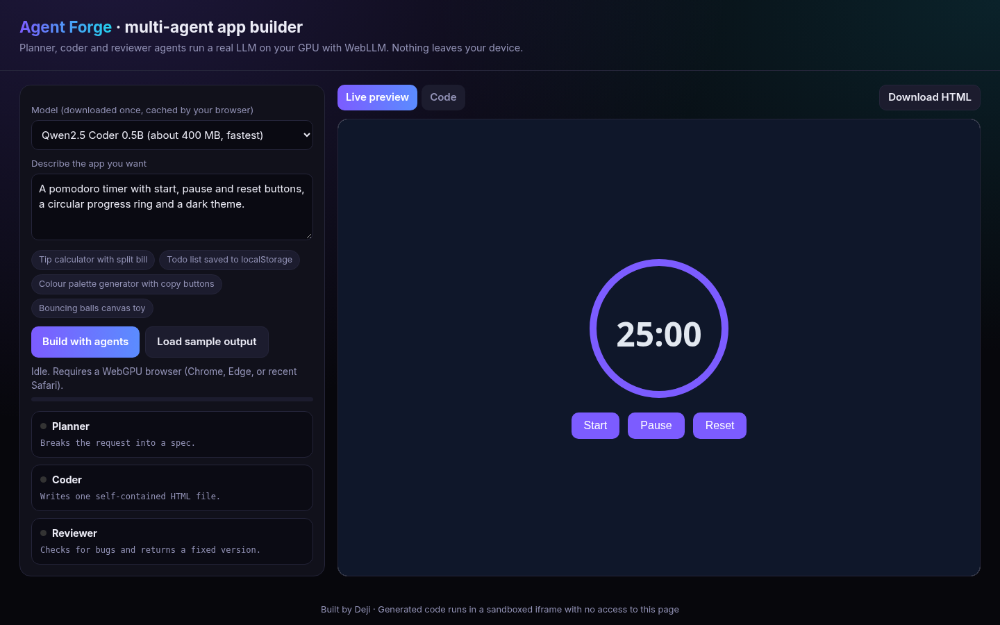

# Agent Forge

A multi-agent AI app builder that runs entirely in your browser. A planner agent writes a spec, a coder agent writes a single-file HTML app and a reviewer agent fixes bugs, all powered by a local LLM through WebLLM. Results render live in a sandboxed iframe.

**Live:** https://josephbepocode.github.io/agent-app-builder/

## Features
- WebLLM (Qwen2.5 Coder 0.5B or 1.5B, q4f16) on WebGPU
- Streaming agent output with per-agent status
- Sandboxed `iframe` preview (scripts only, no same-origin access)
- Code view and HTML download
- Sample output for browsers without WebGPU

## Notes
Needs a WebGPU browser (desktop Chrome or Edge recommended). The first run downloads the model, after that it is cached.

## Run locally
It is a static site. Serve the folder with any static server, for example `python3 -m http.server`, and open `http://localhost:8000`.

No backend, no API keys. Built by Deji.
